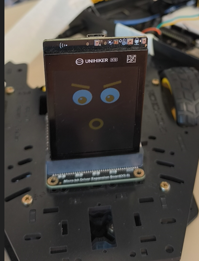

# RoboCarinhas

Um robô de duas rodas que anda para frente, para trás, para a esquerda e para a direita, e troca de carinha na tela da UNIHIKER K10 a cada direção.

Projeto do Tio Rafa (@prof.tiorafa), feito para gerar conhecimento. Todos os materiais foram cedidos gentilmente pela RoboCore.

## O que o robô faz

| Direção | Carinha na tela |
| --- | --- |
| Parado | Olhos azuis de frente e boca reta |
| Frente | Pupilas verdes olhando para cima, bochechas rosa e sorrisão |
| Trás | Pupilas laranja olhando para baixo, sobrancelhas preocupadas e boca em "o" |
| Esquerda | Pupilas azuis para a esquerda, uma sobrancelha levantada e sorriso torto |
| Direita | Pupilas roxas para a direita, espelho da esquerda |

Sequência do programa: frente 4 s, trás 4 s, esquerda 2,5 s, direita 2,5 s, com 1 s de pausa (carinha neutra) entre os movimentos. Tudo é ajustável nas constantes no topo do `RoboCarinhas.ino`.

## Hardware

| Peça | Papel |
| --- | --- |
| [Plataforma Robótica Falcon V2](https://www.robocore.net/kits-didaticos/plataforma-robotica-falcon-v2) | Chassi 2WD com dois motores DC com caixa de redução e duas rodas |
| [UNIHIKER K10](https://www.robocore.net/dfrobot/unihiker-k10) | Cérebro e tela (placa baseada em ESP32-S3) |
| [Controlador de Motores para BBC micro:bit / UNIHIKER K10](https://www.robocore.net/kit-microbit/controlador-motores-bbc-microbit) | Ponte H com I2C, recebe a K10 pelo encaixe |
| [Suporte para 1 Bateria Li-Ion 18650](https://www.robocore.net/baterias-fontes/suporte-para-1-bateria-li-ion-18650) | Sem tampa e sem chave liga/desliga |
| [Bateria Li-Ion 18650 3,7 V 2600 mAh](https://www.robocore.net/baterias-fontes/bateria-li-ion-18650-3-7v-2600mah) | Alimentação |

## Ligações

Não há GPIO ligado direto: a K10 conversa com o controlador por I2C pelo conector de borda, e a biblioteca usa o chip PWM da placa (PCA9685, endereço 0x40).

| Item | Ligação |
| --- | --- |
| Motor esquerdo | Motor 1 do controlador |
| Motor direito | Motor 2 do controlador |
| Bateria 18650 | Borne de alimentação do controlador (3,5 a 5,5 V) |
| Gravação | Cabo USB-C da K10 no computador |

Se um motor girar ao contrário, inverta os dois fios dele. Confira as conexões antes de ligar a K10 no controlador: a RoboCore informa que o controlador foi pensado para a micro:bit e recomenda essa checagem.

## Software

- Arduino IDE com o pacote de placas da UNIHIKER K10 instalado (traz o `unihiker_k10.h`). Siga a [documentação oficial da K10](https://www.unihiker.com/wiki/K10/).
- Biblioteca **TR0548_K10** (a biblioteca do Tio Rafa para o controlador): instale pelo .zip em Sketch, Incluir Biblioteca, Adicionar biblioteca .ZIP.
- *Adafruit PWM Servo Driver Library*, pelo Gerenciador de Bibliotecas (dependência da TR0548_K10).

O sketch usa `#include <TR0548_K10.h>` e o objeto `TR0548_K10 robo;`. A biblioteca (versão 1.1.0) fica no repositório [TR0548_K10](https://github.com/Tio-Rafa-SE/TR0548_K10).

## Como gravar e usar

1. Instale o pacote da K10, a TR0548_K10 e a Adafruit PWM Servo Driver Library.
2. Abra `RoboCarinhas/RoboCarinhas.ino` na Arduino IDE.
3. Selecione a placa UNIHIKER K10 e a porta da K10.
4. Deixe o robô com as rodas no ar, coloque a bateria e grave o programa.
5. Ao terminar, ele repete a sequência de movimentos em loop.

## Resultado esperado

1. A tela mostra a carinha neutra.
2. Frente por 4 s com a carinha de frente, depois para e volta à carinha neutra.
3. Trás por 4 s com a carinha de ré.
4. Giro para a esquerda por 2,5 s, depois giro para a direita por 2,5 s, cada um com a sua carinha.
5. A sequência recomeça.

## Testes realizados

| Verificação | Situação |
| --- | --- |
| Análise do código | Feita, contra os arquivos da biblioteca TR0548_K10 1.1.0 |
| Compilação | Não realizada no ambiente em que o código foi escrito; compile na sua Arduino IDE antes de gravar |
| Teste no robô (versão sem voz) | Executado no robô montado, com as carinhas na tela da K10 |
| Comando de voz | Ainda não funciona (veja abaixo) |

## Problemas conhecidos e próximo passo

Nas primeiras tentativas de somar comandos de voz (reconhecimento offline da K10) ao programa com tela e motores, a K10 ficou reiniciando. Por isso esta versão não usa voz. O próximo passo é testar o exemplo oficial de voz sozinho, depois somar a tela e os motores um de cada vez, até achar onde a placa reinicia. Os comandos previstos, em inglês, são `go forward`, `go back`, `turn left`, `turn right` e `stop`.

## Licença

MIT, em `LICENSE`.
